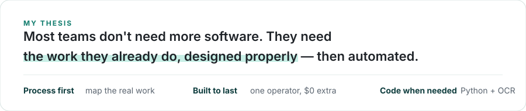
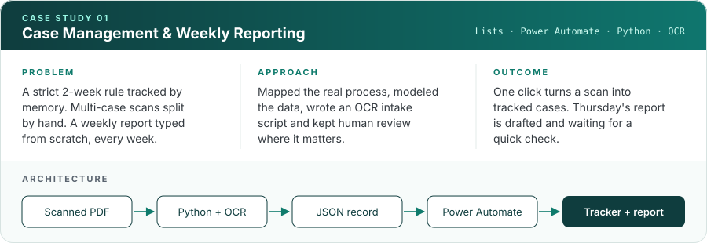

  

  

## Case studies

  <a href="case-studies/01-case-management-weekly-reporting.md"><b>Read the full case →</b></a>
  &nbsp;·&nbsp;
  <a href="tools/pdf-case-splitter/">View the intake code</a>

## Tools

  <a href="https://github.com/vivalcala/pdf-form-splitter"><b>Explore the tool →</b></a>
  &nbsp;·&nbsp;
  Built for a real intake problem, then generalized for any document type.

## How I work

| | |
|---|---|
| **Data first, automation second** | Clean structure before any flow. |
| **Work within constraints** | No extra licenses, no premium connectors, locked-down tenants. |
| **Verify the live system** | A documented design is not a built system. |
| **Privacy by design** | Users submit through forms and never see internal data. |
| **Human review where it matters** | Automation drafts; people approve what leaves the system. |

## Toolkit

Requirements analysis · Process mapping · Data modeling · OCR & document automation · Technical documentation

## About

**Target roles:** Business Systems Analyst · Power Platform Developer · long-term: Solutions Architect
**Education:** B.S. Information Systems Technology (Software Engineering), Miami Dade College, 2026 · B.A. Organizational Communication, Florida International University

All case studies use fictional data. They show system design and process thinking, not real records.
