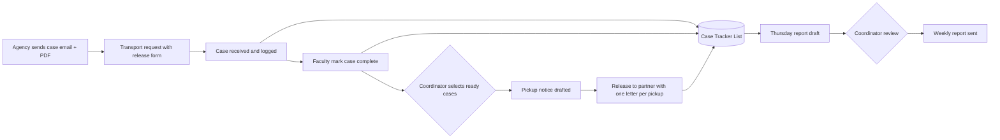
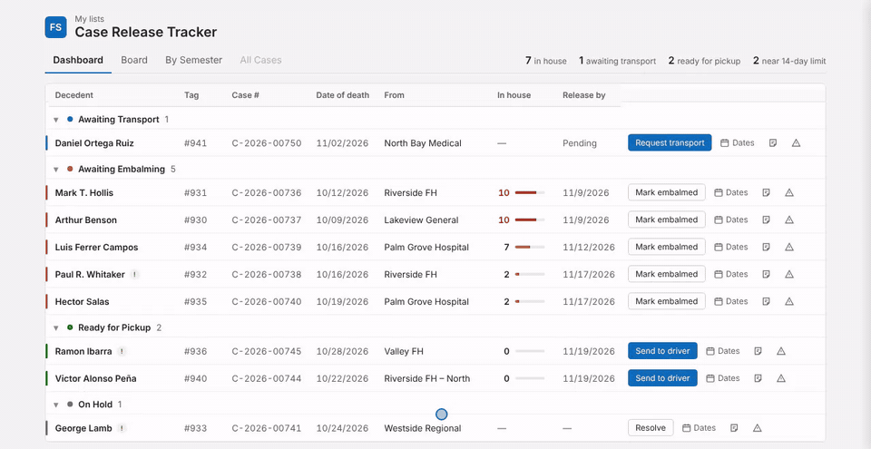
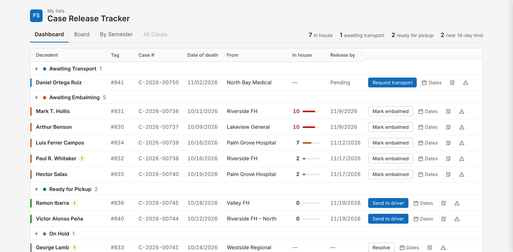

# 01 — Case Management & Weekly Reporting

> Fictional data. This case study shows the process and system design I built for a college lab program. No real case records, names or partner details are included.

## Problem

A mortuary science program receives cases from a county agency for hands-on lab instruction. The whole process ran on paper: a case call form, a handwritten log in the receiving area, and emails typed from scratch. The person who managed it left, and the coordinator inherited it with no system behind it.

Pain points:

- Case data was copied by hand from emails and PDFs into a log, then retyped into reports.
- Faculty and drivers recorded dates and status on paper, so the coordinator had to transcribe them.
- A strict time limit (cases may stay on site no longer than 2 weeks) was tracked by memory.
- A weekly report to the agency and leadership was written manually every week.

## Constraints

- Only the college's Microsoft 365 license: Lists, Power Automate (standard connectors), Outlook.
- Faculty and drivers are not technical users.
- Nothing leaves the system without human review.
- The coordinator is not on site on Fridays, so the weekly cycle runs Thursday to Thursday.

## Solution

An Excel tracker migrated to a **Microsoft List**, a **Python intake script** that splits and reads incoming forms, and **Power Automate** flows that create cases and draft the recurring communications for the coordinator to approve.

### Process

### Intake automation: from one PDF to tracked cases

Release forms arrive as one PDF with several cases, often a scanned copy. A Python script I wrote, the **[PDF Case Splitter](../tools/pdf-case-splitter/)**, reads every page (with OCR for scans), extracts the case data and saves one PDF plus one JSON record per case to a synced folder. A Power Automate flow then:

1. Looks up the case by its ID in the tracker, and creates it if it does not exist.
2. Files the PDF in the case documents library by term and month.
3. Attaches the PDF to the tracker row, ready for the transport request.

Pages the script cannot read go to a review folder, so a bad scan never creates a wrong record.

### Case Tracker data model

| Field Name | Data Type | Source/Trigger | Automation Action |
|---|---|---|---|
| Case ID (agency) | Single line text | Release PDF | Key for matching documents |
| Internal Tag | Single line text | Assigned on arrival | Shown on all internal forms |
| Name (First Last) | Single line text | Release PDF | Formatted First Last in every output |
| Source | Choice (fill-in) | Release PDF | Facility name only; phone numbers stripped, location kept |
| Date Received | Date | Dashboard / Board | Starts the 2-week clock |
| Embalmed | Yes/No | "Mark embalmed" button | Moves the case to Ready for Pickup |
| Date Released | Date | Dashboard / Board | Closes the case |
| Hold | Choice | Issue flow | Blocks transport requests |
| Status | Calculated: Hold → Released → Received → Embalmed | Dates above | Single source of truth for every view and flow |
| Stage | Choice | Board drag / sync flow | Board columns |
| Semester, Month | Calculated | Date Received | Grouping for term reports |
| Notes | Multi-line text | Coordinator / Issue flow | Shown on the row; included in driver and weekly emails |

### Dashboard: every action on the row

Static screenshot

The default view groups cases by status, shows days on site (red from day 10) and puts the next action on each row. Columns and buttons sit in fixed slots, so they line up even when a row hides a button.

| Status | Row action | What happens |
|---|---|---|
| Awaiting Transport | Request transport → Send to driver | One email to the driver with every marked case and its release form |
| Awaiting Embalming | Mark embalmed | Status moves to Ready for Pickup |
| Ready for Pickup | Add to pickup → Send to driver | Pickup notice with notes and the partner's release letter |
| On Hold | Resolve | Opens the case to clear the hold |

Fixed icons on every row:

- **Email** opens a draft to the source facility, with the case already filled in.
- **Call** shows the facility's number.
- **Dates** and **Note** open the case form; status recalculates from the dates.
- **Report issue** asks for the issue type and details, adds a dated note, puts the case on hold, and sends an approval before the agency is notified.

**Ask partner** in the "Ready for Pickup" header opens a draft asking the release partner for space for *N* cases. The count is filled in automatically.

### Other views

| View | Purpose |
|---|---|
| Board | Drag a case between stages. A flow keeps dates and stage in sync both ways, using a hidden "last synced stage" field so it never loops |
| By Semester | Cases grouped by term (Fall Aug–Dec, Spring Jan–Apr, Summer May–Jul) and month, with counts |
| All Cases | The full record: ten columns, no buttons, status shown as a colored dot |

### Business rules built in

- **2-week limit:** days on site turn red at day 10. If a closure would push a case past the limit, it is released regardless of status.
- **Selected, not automatic:** pickup notices go only for cases the coordinator selects.
- **One letter per pickup:** a single release letter can cover several cases.
- **Weekly report:** drafted every Thursday around 2 PM for the Thursday-to-Thursday window, with that week's release letters, then reviewed before sending.

## Results

*To be added with real, approved numbers (for example: minutes per weekly report before and after, paper forms retired).*

## Design decisions

- **Status is calculated, never typed.** Every view and flow reads the same formula, so they can't disagree.
- **Contact without new systems.** The facility email and phone lookup lives in the view formatting, and drafts open in the coordinator's own mail client. Nothing new to maintain.
- **Actions in one place.** The Dashboard is for work; the full-record view stays clean and read-only.
- **Folder IDs, not paths.** Flows trigger on folder IDs, and the intake script finds its output folder by name, so reorganizing folders doesn't break intake.

## Skills shown

Process mapping · Business rules analysis · Python (PDF parsing, OCR) · Microsoft Lists · JSON view formatting · SharePoint REST · Power Automate · Human-in-the-loop automation · Stakeholder-friendly design
