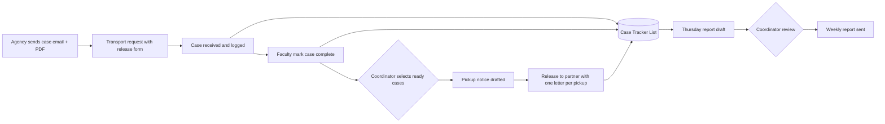

# 01 — Case Management & Weekly Reporting

> Fictional data. This case study shows the process and system design I built for a college lab program. No real case records, names or partner details are included.

## Problem

A mortuary science program receives cases from a county agency for hands-on lab instruction. The whole process ran on paper: a case call form, a handwritten log in the receiving area, and emails typed from scratch. The person who managed it left, and the coordinator inherited it with no system behind it.

Pain points:

- Case data was copied by hand from emails and PDFs into a log, then retyped into reports.
- Faculty and drivers recorded dates and status on paper, so the coordinator had to transcribe them.
- A strict time limit (cases may stay on site no longer than 2 weeks) was tracked by memory.
- A weekly report to the agency and leadership was written manually every week.

## Constraints

- Only the college's Microsoft 365 license: Lists, Power Automate (standard connectors), Outlook.
- Faculty and drivers are not technical users.
- Nothing leaves the system without human review.
- The coordinator is not on site on Fridays, so the weekly cycle runs Thursday to Thursday.

## Solution

An Excel tracker migrated to a **Microsoft List**, a **Python intake script** that splits and reads incoming forms, and **Power Automate** flows that create cases and draft the recurring communications for the coordinator to approve.

### Process

### Intake automation: from one PDF to tracked cases

Release forms arrive as one PDF with several cases, often a scanned copy. A Python script I wrote, the **[PDF Case Splitter](../tools/pdf-case-splitter/)**, reads every page (with OCR for scans), extracts the case data and saves one PDF plus one JSON record per case to a synced folder. A Power Automate flow then:

1. Looks up the case by its ID in the tracker, and creates it if it does not exist.
2. Files the PDF in the case documents library by term and month.
3. Attaches the PDF to the tracker row, ready for the transport request.

Pages the script cannot read go to a review folder, so a bad scan never creates a wrong record.

### Case Tracker data model

| Field Name | Data Type | Source/Trigger | Automation Action |
|---|---|---|---|
| Case ID (agency) | Single line text | Agency email | Key for matching documents |
| Internal Tag | Single line text | Assigned on arrival | Shown on all internal forms |
| Name (First Last) | Single line text | Release PDF | Formatted First Last in every output |
| Source | Choice | Release PDF | Grouping in reports |
| Date Received | Date | Driver / coordinator | Starts the 2-week clock |
| Days On Site | Calculated | Date Received | Flags cases near the limit |
| Status | Choice: Requested / Received / Complete / Released | Faculty / coordinator | Drives the weekly report |
| Date Released | Date | Coordinator | Closes the case |
| Release Letter | Hyperlink | Upload | Attached to the weekly report |

### Business rules built in

- **2-week limit:** cases near 14 days on site are flagged. If a closure would push a case past the limit, it is released regardless of status.
- **Selected, not automatic:** pickup notices go only for cases the coordinator selects.
- **One letter per pickup:** a single release letter can cover several cases.
- **Weekly report:** drafted every Thursday around 2 PM for the Thursday-to-Thursday window, with that week's release letters, then reviewed before sending.

## Results

*To be added with real, approved numbers (for example: minutes per weekly report before and after, paper forms retired).*

## What I would do next

1. A simple entry point (a Form or a mobile List view) so faculty and drivers record status directly instead of on paper.
2. A visual dashboard of cases by status and days on site.
3. An alert when a case reaches 10 days on site.

## Skills shown

Process mapping · Business rules analysis · Python (PDF parsing, OCR) · Microsoft Lists · Power Automate · Human-in-the-loop automation · Stakeholder-friendly design
