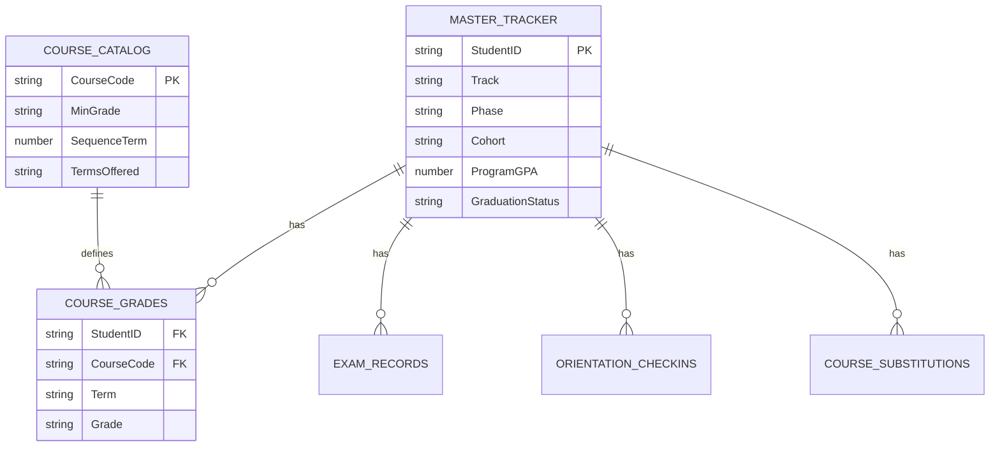
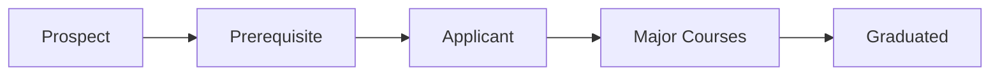

# 01 — Student Information System on Microsoft Lists

> Fictional data. This case study shows the design of a system I built for a small accredited college program. No real student records are included.

## Problem

A small, accredited career program tracked every student by hand. One coordinator checked prerequisites, grades, GPA and exam results one student at a time in the college portal. Accreditation reports needed outcome data (pass, graduation and employment rates) that no single place held.

## Constraints

- Only the college's existing Microsoft 365 license: no extra budget, no premium connectors.
- One person runs the whole system.
- Student privacy law (FERPA): students never see internal data or other students' records.
- The accrediting body sets the metrics the program must report.

## Solution

A relational student information system built natively in **Microsoft Lists**, with a single student ID linking every table to one master record. Students submit data through **Microsoft Forms**, never directly into Lists.

### Data model

| Table | Role |
|---|---|
| Master_Tracker | One record per student: 49 fields in 8 groups (identity, phase, application gate, cohort, requirements, GPA compliance, demographics for accreditation, graduation outcomes) |
| Course_Grades | One row per student, course and term |
| Exam_Records | Licensing exam attempts and results |
| Orientation_Checkins | Required orientation RSVP and check-in |
| Course_Substitutions | Approved exceptions |
| Course_Catalog | Courses, minimum grade, sequence, terms offered |

### Student lifecycle

Three tracks share the same model: a full degree pipeline, a shorter certificate pipeline with no licensing exam, and a rare minimal track.

### Accreditation metrics

The system captures what the accrediting body asks for: licensing exam pass rate, graduation rate and employment rate (the program must meet two of three), plus an upcoming persistence rate.

## Results

*To be added with real, approved numbers (for example: time saved per term, manual checks removed).*

## What I would do next

1. Import end-of-term grades from the college portal into Course_Grades with Power Automate.
2. Compare each grade with Course_Catalog and flag students below the minimum.
3. Send an end-of-term GPA and risk summary automatically.
4. Predict course demand two to three terms ahead to plan sections.

## Skills shown

Requirements analysis · Relational data modeling · Microsoft Lists · Microsoft Forms · Privacy by design · Accreditation reporting
