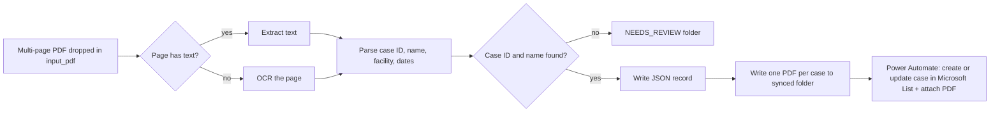

# PDF Case Splitter

> Part of [Case Management & Weekly Reporting](../../case-studies/01-case-management-weekly-reporting.md). All names, IDs and facilities here are fictional.

A Python script that turns one multi-page PDF of release forms into **one PDF per case** plus a **JSON record** that a Power Automate flow uses to create the case in a Microsoft List. It reads digital PDFs and scanned copies (OCR).

## The problem it solves

Release forms arrived as a single PDF with several cases inside, often a copier scan with no text layer. Each page had to be split by hand, renamed, filed, and its data typed into the tracker.

## How it works



**Design choices**

- **OCR only when needed:** pages with a text layer are read directly; the OCR engine loads only for scanned pages.
- **Never guess:** a page without a readable case ID and name goes to `NEEDS_REVIEW` instead of creating a wrong record.
- **Data before trigger:** the JSON is written before the PDF, because the flow fires on the PDF and must find the data ready.
- **Clean names:** `DOE, JANE A` becomes `Jane A Doe`; IDs are normalized (`P2026-101` → `P2026-00101`); OCR-glued facility names are matched against `facilities.txt`.
- **One-click use:** two `.bat` files so a non-technical user can install once and run with a double-click.

## Example (fictional)

Input: [`samples/sample_release_forms.pdf`](samples/sample_release_forms.pdf), 3 pages.

```
sample_release_forms.pdf  (3 pages)
   page 1: P2026-00101_Jane_A_Doe.pdf  | Riverside General Hospital | DOD 2026-10-20 | release 2026-10-22
   page 2: P2026-00102_John_R_Smith.pdf  | Bayview Medical Center | DOD 2026-10-21 | release 2026-10-23
   page 3: P2026-00103_Maria_Garcia.pdf  | Coastal Memorial Hospital | DOD 2026-10-22 | release 2026-10-24

Done: 3 case(s) saved, 0 page(s) need review.
```

JSON record for page 1:

```json
{
  "caseId": "P2026-00101",
  "name": "Jane A Doe",
  "facility": "Riverside General Hospital",
  "releaseDate": "2026-10-22",
  "dob": "1948-03-14",
  "dod": "2026-10-20",
  "file": "P2026-00101_Jane_A_Doe.pdf",
  "sourceFile": "sample_release_forms.pdf"
}
```

## Run it

**Windows (one click):** double-click `1_INSTALL_once.bat` once, then `2_RUN_split.bat` each time.

**Any OS:**

```bash
pip install pypdf pypdfium2 rapidocr-onnxruntime numpy
mkdir input_pdf && cp samples/sample_release_forms.pdf input_pdf/
python split_cases.py
```

Set `CASE_OUTPUT_FOLDER` to a synced folder (for example OneDrive) watched by Power Automate. Without it, results go to `./output`.

## Stack

Python · pypdf · pypdfium2 · RapidOCR · Power Automate · Microsoft Lists · OneDrive
